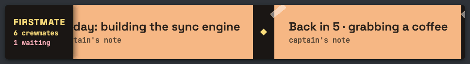

# fleetnotes

Sticky notes for your live stream, and an optional ticker of what your [Firstmate](https://github.com/kunchenguid/firstmate) agent crew is doing, filtered so that only what you approved ever reaches the screen.



<sub>The demo uses made-up notes and projects.</sub>

fleetnotes draws a strip of sticky notes in your streaming software (any app with a browser source, such as OBS) that scrolls like a TV news ticker. It has two parts:

- **Captain's notes.** Short notes you type in a terminal: one pinned note ("Today: building the sync engine") and one temporary note ("Back in 5"). They need nothing else.
- **Fleet notes (optional).** If you run a crew of coding agents with Firstmate, the strip also shows who is doing what, such as "Lighthouse · the chat bot answers questions — validating · CI", with an anonymous header like "FIRSTMATE · 7 crewmates · 1 waiting". Nothing about a project is shown until you allow that project, and every text passes a blocklist first.

It is a small Python tool with no dependencies, for macOS and Linux.

## Quick start

You need Python 3.11 or newer.

```sh
pipx install git+https://github.com/mikeastwoody/fleetnotes
fleetnotes serve        # keep this running; it prints the overlay's address
```

Then, in another terminal:

```sh
fleetnotes pin "Today: building the sync engine"
```

In OBS, add a **Browser** source:

- URL: `http://127.0.0.1:8765/`
- Width `968`, height `132`
- Tick **Shutdown source when not visible**

The note appears within five seconds. To change the scrolling speed, add `?speed=120` to the URL (20 to 240 pixels per second; the default is 60).

To show the overlay in Spanish, add `?lang=es` (with a speed too: `?speed=120&lang=es`). The phrases, the header and the ages change, for example "El secondmate de Driftwood · Slack integration — espera al capitán · 4 min" and "FIRSTMATE · 7 crewmates · 1 espera". Your notes and the task labels are shown as you wrote them. Without the parameter, or with any other value, the overlay is in English.

## Captain's notes

```sh
fleetnotes add "Chat: what is a crewmate?"     # temporary, 30 minutes
fleetnotes add "Long break at 18:00" --for 2h  # 30m, 2h, 1h30m (up to 12 h)
fleetnotes pin "Today: notes that update themselves"
fleetnotes list                                # what is stored and what is shown
fleetnotes rm 2                                # remove note 2 of the list
fleetnotes clear                               # remove every note
fleetnotes off                                 # panic switch: the overlay draws nothing
fleetnotes on
```

The overlay shows the newest pinned note and the newest temporary note. A note can be up to 90 characters long, and an emoji counts as 2. A new pinned note replaces the previous one.

Every note is checked before it is written. A note is refused if it mentions credentials, money (prices, invoices, revenue), clients, file paths, email addresses or links, or if it contains one of your own blocked phrases. The error names the rule that matched and never repeats your text, because your terminal may be on stream.

## Fleet notes (optional, for Firstmate users)

fleetnotes reads your fleet only through Firstmate's own read-only view, `bin/fm-fleet-snapshot.sh --json`. It never opens Firstmate's data or state folders and never writes anything there.

1. Point the config at your Firstmate home (see [Configuration](#configuration)):

   ```toml
   [fleet]
   firstmate_home = "~/firstmate"
   ```

2. Allow the projects you are happy to show, each under a public name of up to 16 characters:

   ```sh
   fleetnotes fleet allow lighthouse "Lighthouse"
   ```

3. Preview what would be published. This writes nothing:

   ```sh
   fleetnotes fleet plan
   ```

4. Keep the feed fresh while you stream:

   ```sh
   fleetnotes fleet watch      # until Ctrl-C; removes the feed when it stops
   ```

Each fleet note says who is working and on what. "Who" is the project's public name, "Secondmate of <project>" for work in a secondmate's home, or "<machine>: <project>" for a machine listed in `[[fleet.remotes]]`. "What" is the label you approved for that task (`fleetnotes fleet label <task-id> "what it does"`) or, if there is none, the task's title after cleaning. When nothing public is left of the title, the note reads "a crewmate at work".

### What the public filter does

The fleet feed is **closed by default**:

- Without an allowed project, nothing is published. A broken rules file, or `fleetnotes off`, also publishes nothing.
- Tasks of projects you have not allowed only add to the anonymous counts in the header.
- Titles lose asides in brackets, ticket numbers, hashes, task ids, paths, file names, domains, IP addresses, links and email addresses, and are cut at a word boundary. A title that still matches a blocked word, or names a project you have not allowed, is dropped whole: a title is shown complete or not at all.
- A label or name that contains any task id is never shown.
- Task ids are replaced by an opaque key (an HMAC with a local salt). Backlog notes, status messages, paths, pull requests and ssh hosts are used only to decide; they are never copied into the feed.
- `deny` and `unlabel` reach the screen at the overlay's next read. `allow` and `label` wait for the next refresh, which checks them against every task id first.

The rules live in a private file (by default `~/.config/fleetnotes/rules.conf`, mode 600). The commands above edit it for you; see [`examples/rules.example.conf`](examples/rules.example.conf) for its format. `fleetnotes fleet plan --ids` adds the task ids to the preview so you can label them. It refuses while `FLEETNOTES_ON_AIR=1` is set, so export that variable in the terminal you stream from.

### Other machines

To include a Firstmate home on another computer, add it to the config. fleetnotes runs that machine's read-only view over ssh in batch mode, so it never prompts for a password, and it gives up after `snapshot_timeout`. A machine that does not answer is left out and counted in the log. The other machine needs key-based ssh access, `/bin/sh` and `perl`, which macOS and most Linux systems include.

```toml
[[fleet.remotes]]
name = "Studio Mac"            # public
host = "studio"                # ssh destination or ~/.ssh/config alias
home = "/Users/you/firstmate"
```

## Configuration

Everything works without a config file: the captain's notes use the defaults below and the fleet feed stays off. To change something, copy [`examples/config.example.toml`](examples/config.example.toml) to `~/.config/fleetnotes/config.toml`, or point `FLEETNOTES_CONFIG` or `--config` at another file.

| Key | Default | What it is |
|---|---|---|
| `output_dir` | `~/.local/share/fleetnotes/public` | The two public JSON files the overlay reads |
| `state_dir` | `~/.local/state/fleetnotes` | Private files: lock, salt, the `off` switch |
| `rules_file` | `rules.conf` next to the config | Private fleet rules |
| `blocked_phrases` | none | Extra phrases no public text may contain |
| `serve.host`, `serve.port` | `127.0.0.1`, `8765` | Where `fleetnotes serve` listens |
| `fleet.firstmate_home` | empty (feed off) | Your Firstmate home |
| `fleet.refresh_seconds` | `60` | 5 to 90 |
| `fleet.snapshot_timeout` | `45` | 5 to 60 |
| `fleet.remotes` | none | Up to 4 other machines |

`XDG_CONFIG_HOME`, `XDG_DATA_HOME` and `XDG_STATE_HOME` are respected. fleetnotes needs no secrets, so none go in this file.

## Safety notes

- `fleetnotes serve` listens on `127.0.0.1` and answers only the overlay and its two JSON files. It never serves the rest of any folder.
- The overlay inserts every text as plain text, never as HTML, and accepts only the fields of its [file contracts](docs/contracts.md).
- The CLI shows your home folder as `~`, and the watcher's log has counts and rule names only, never titles, labels or ids.
- The overlay loads the Space Grotesk and JetBrains Mono fonts from Google Fonts. Without a network connection it falls back to system fonts.
- Your streaming software shows whatever is in `output_dir`. Do not point it at a folder that holds anything else.

## Using it from your own tools

fleetnotes is also a library. A streaming toolkit that knows when the stream is live can pass that to the CLI, so that `fleet watch` stops with the stream and `fleet plan --ids` refuses while it is live:

```python
from fleetnotes.cli import main

main(["fleet", "watch"], should_stop=lambda: not stream_is_live(), on_air=stream_is_live)
```

`fleetnotes.notes.NoteStore` and `fleetnotes.fleet.build_feed` are the pieces underneath. The two JSON files are documented in [docs/contracts.md](docs/contracts.md).

## Development

```sh
git clone https://github.com/mikeastwoody/fleetnotes
cd fleetnotes
python3 -m unittest discover -s tests -t . -v
```

The overlay tests need Chrome or Chromium and are skipped without one (set `CHROME_BIN` to point at it). See [CONTRIBUTING.md](CONTRIBUTING.md).

## Status

This is a personal project, shared as is. It comes with no support and no response times. Issues are welcome. Please report security problems privately, as described in [SECURITY.md](SECURITY.md).

fleetnotes is not affiliated with Firstmate. It only runs Firstmate's own read-only view.

## License

[MIT](LICENSE). The license covers the code. It does not grant any right to the author's name, brand or logos.
